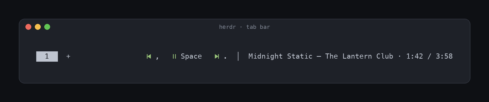
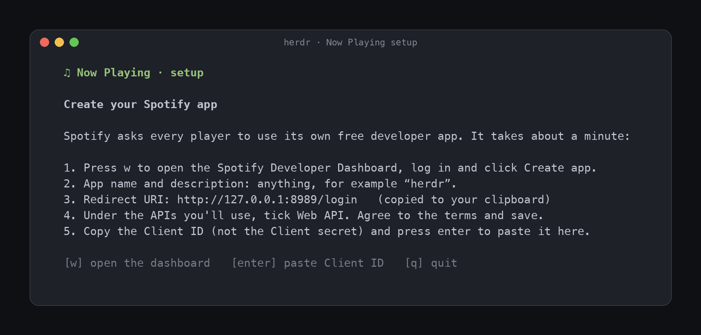

# Now Playing for Spotify — a herdr plugin

See and control what's playing on Spotify without leaving [herdr](https://herdr.dev):

- **Player pane**: track, artist, album, progress, volume, shuffle/repeat, with keyboard controls
- **Search**: find tracks, albums, artists and playlists and play them, from the pane or the CLI
- **Tab bar**: what's playing and the playback keys on the right of herdr's tab row (herdr 0.9.0+)
- **Agents panel**: the player pane shows up as an agent, titled with the current track
- **CLI**: `nowplaying next`, `nowplaying now`, … for scripts and key bindings
- **Guided setup**: one popup takes you from install to music playing, no config files to edit

<p>
  
  
</p>
<p>
  
</p>

<sub>Track names in the screenshots are fictional demo data.</sub>

> **Not affiliated with Spotify.** This is an unofficial, community plugin. "Spotify" is a trademark
> of Spotify AB, used here only to describe compatibility.

## Requirements

- herdr 0.7.5 or newer, macOS (the tab bar line needs herdr 0.9.0+)
- Python 3.9+ (the system `python3` works; standard library only)
- One of these players:

| Player | What plays the music | Spotify account |
|---|---|---|
| **spotify_player** | the headless [`spotify_player`](https://github.com/aome510/spotify-player) daemon, in the background, no Spotify app needed. Setup builds it and walks you through a free Spotify developer app. | **Premium** |
| **Spotify desktop app** | the Spotify app you already use. Nothing to set up. | Free or Premium |

## Install

```sh
herdr plugin install reidsolon/herdr-nowplaying
herdr plugin action invoke reidsolon.nowplaying.setup
```

The second command opens setup in a popup. Setup also opens the first time you open the player, and
herdr reminds you at startup until it's done.



Setup walks you through:

1. **Choosing a player**: spotify_player or the Spotify desktop app.
2. **Installing spotify_player**: if it's missing, setup builds it with Rust's `cargo` (about
   5 minutes). If you don't have Rust, it points you to [rustup.rs](https://rustup.rs).
3. **Your Spotify Client ID**: Spotify requires each player to use its own free developer app.
   Setup opens the [Developer Dashboard](https://developer.spotify.com/dashboard), copies the
   Redirect URI to your clipboard and tells you what to tick. You paste the Client ID back, and
   setup writes `~/.config/spotify-player/app.toml` for you.
4. **Logging in**: up to three Spotify pages open in your browser, one after another:
   1. **your app**, for playback, search and controls;
   2. **ncspot**, spotify_player's backup for a few features Spotify restricts for new personal
      apps, such as reading your playlists. Seeing ncspot here is expected;
   3. **Spotify**, the streaming login that plays the audio.
5. **Extras**, each optional: start spotify_player with herdr, `prefix m` to open the player,
   `prefix , / space / .` for playback, what's playing in herdr's tab bar, and moving the tab bar
   to the bottom. Setup backs up your herdr config, skips keys you already use, checks the result
   with `herdr config check` (undoing its change if herdr reports a new problem) and reloads herdr.

Setup also installs the `nowplaying` command in `~/.local/bin`. It looks up the plugin's current
install each time it runs, so it keeps working after `herdr plugin update`. Run setup again any time
with `nowplaying setup`; it skips the steps that are already done.

Prefer to do it by hand? See [Manual setup](#manual-setup).

## Usage

To start music: open the player (`prefix m`, or `nowplaying`), press `/` to search, or press `t` to
move what's playing on another device (your phone, the Spotify app) to the "herdr" device.

### Player keys

| Key | Action | Key | Action |
|---|---|---|---|
| `space` | play / pause | `s` | shuffle |
| `n` / `p` | next / previous | `r` | repeat |
| `←` / `→` | seek ∓10s | `w` | open track in Spotify |
| `+` / `-` | volume | `t` | play on the spotify_player device |
| `o` | start the player/app | `q` | close the pane (music keeps playing) |
| `/` | search | `a` | log in (shown when you're logged out) |

In search results: `↑`/`↓` (or `j`/`k`) select, `Tab`/`←`/`→` switch category, `Enter` plays the
track, album, artist or playlist, `/` searches again, `Esc` goes back. Search needs spotify_player;
with the Spotify app, `/` opens the app's own search.

The pane never waits on Spotify: play/pause and volume update instantly, a picked result shows as
"starting…" right away, and the plugin confirms Spotify actually switched (retrying once if it
didn't) before showing it as playing.

### CLI

```
nowplaying            open the player (split pane; switches to it if already open)
nowplaying popup      open the player as a popup
nowplaying play       play/pause            nowplaying next | prev   skip
nowplaying now        print what's playing  nowplaying web           open track in Spotify
nowplaying bar        one-line status for herdr's tab bar
nowplaying here       move playback to the spotify_player device
nowplaying search <query>          list tracks, albums, artists, playlists
nowplaying search --play <query>   play the top track
nowplaying login      log in to Spotify in your browser, then start the daemon
nowplaying daemon     start the spotify_player daemon
nowplaying setup      set everything up step by step
```

The main commands are also plugin actions, for key bindings or when `nowplaying` isn't on your PATH:
`herdr plugin action invoke reidsolon.nowplaying.<setup|open|open-popup|play-pause|next|previous|play-here>`.

### Key bindings

Setup can add these for you. To add them by hand, put them in `~/.config/herdr/config.toml`:

```toml
[[keys.command]]
key = "prefix+m"
type = "plugin_action"
command = "reidsolon.nowplaying.open-popup"   # or .open for a split pane
description = "now playing"

[[keys.command]]
key = "prefix+comma"
type = "plugin_action"
command = "reidsolon.nowplaying.previous"
description = "previous track"

[[keys.command]]
key = "prefix+space"
type = "plugin_action"
command = "reidsolon.nowplaying.play-pause"
description = "play / pause"

[[keys.command]]
key = "prefix+period"
type = "plugin_action"
command = "reidsolon.nowplaying.next"
description = "next track"
```

### Tab bar (herdr 0.9.0+)

Setup can add this for you. To add it by hand, merge this into the `[ui]` section of
`~/.config/herdr/config.toml` (add to an existing `tab_bar_right` list rather than replacing it),
then choose reload config from herdr's menu:

```toml
[ui]
tab_bar_position = "bottom"            # optional; the default is "top"
hide_tab_bar_when_single_tab = false   # keep it visible with one tab
tab_bar_right = [
  { type = "command", command = "~/.local/bin/nowplaying bar", interval_seconds = 5, timeout_seconds = 4 },
]
```

The hints in the bar are text, not buttons: they show the playback keys from
[Key bindings](#key-bindings). Setup shows hints only for keys it actually bound; change them with
the `bar_*` settings below, or hide them with `bar_controls = false`. The bar hides itself when
nothing is playing, and the time updates on each refresh rather than ticking. The bar only reads
playback state; it never starts or restarts spotify_player. Each refresh is one Spotify Web API
request, so keep the interval at a few seconds.

## Configuration

Setup writes `config.toml` in the plugin's config directory
(`herdr plugin config-dir reidsolon.nowplaying`). Edit it any time;
[`config.example.toml`](config.example.toml) describes every setting.

| Key | Default | |
|---|---|---|
| `backend` | `"auto"` | `spotify_player`, `applescript` (the Spotify app), or `auto`: spotify_player if installed, otherwise the app |
| `spotify_player_bin` | `""` | path if not on PATH or in `~/.cargo/bin` |
| `autostart_player` | `false` | start the spotify_player daemon when the herdr server starts (setup turns it on if you keep that extra) |
| `bar_controls` | `true` | show key hints before the track in `nowplaying bar` |
| `bar_key_previous` | `","` | hint for previous; `""` hides it |
| `bar_key_play_pause` | `"Space"` | hint for play/pause; `""` hides it |
| `bar_key_next` | `"."` | hint for next; `""` hides it |

## Privacy

This plugin collects nothing and sends nothing anywhere except to Spotify, for logging in.

- It reads playback state from the Spotify app (AppleScript) or the local `spotify_player` CLI.
- It reads `spotify_player`'s local log only to detect failed requests (rate limits, a lost device).
- Logins: `spotify_player` handles your app's login and the streaming login. The plugin does the
  ncspot login itself (see [Troubleshooting](#troubleshooting) for why), talking only to
  `accounts.spotify.com`. All tokens are stored in `~/.cache/spotify-player/`.
- Setup writes only these files, and only for the steps you choose: the plugin's `config.toml`,
  `~/.config/spotify-player/app.toml` (your Client ID), `~/.local/bin/nowplaying`, and
  `~/.config/herdr/config.toml` (backed up to `config.toml.bak-nowplaying` first). Building
  `spotify_player` runs `cargo install`, which downloads crates from crates.io.

## Compliance notes

- **No credentials of ours are shipped.** Each user registers their own client ID, as the
  [Spotify Developer Policy](https://developer.spotify.com/policy) requires one set of credentials
  per app. The only other client ID the plugin uses is ncspot's public one, and only for the backup
  login spotify_player itself requires (spotify_player ships the same ID).
- **Premium** is required by Spotify for playback through third-party players such as
  spotify_player.
- **`spotify_player` is not part of this plugin.** It is a separate MIT-licensed project built on
  [librespot](https://github.com/librespot-org/librespot), an unofficial Spotify client
  library. Setup can build it for you, but you run it yourself; review its terms and Spotify's
  [Developer Terms](https://developer.spotify.com/terms) before using it.
- **Attribution**: Spotify metadata is shown alongside the Spotify name, and `w` / `nowplaying web`
  links back to the track on Spotify, per the
  [Design & Branding Guidelines](https://developer.spotify.com/documentation/design). Logos can't be
  drawn in a terminal, so the name is used in text.
- The plugin name uses "for Spotify" to describe compatibility, as Spotify's guidelines allow, and
  does not use Spotify logos.

## Troubleshooting

- **An "ncspot" page appears when logging in**: expected. See step 4 of [Install](#install).
- **`redirect_uri: Not matching configuration` with `client_id=d420a117…` in the address bar**:
  that's ncspot's page, opened by `spotify_player authenticate`. In spotify_player 0.25.1 that
  command asks ncspot's app for a redirect URI the app no longer accepts. Log in through the plugin
  instead (`a` in the player, `nowplaying login` or setup); it does the ncspot login on the address
  ncspot's app accepts.
- **`INVALID_CLIENT: Invalid redirect URI` with your own `client_id=`**: add exactly
  `http://127.0.0.1:8989/login` to your app's Redirect URIs in the Spotify dashboard.
- **"Not logged in to Spotify"**: press `a` in the player or run `nowplaying login`.
- **Controls lag or do nothing, the pane says "rate-limited (429)"**: you're on the shared default
  client ID. Run `nowplaying setup` to set your own, then log in again.
- **Paused at 0:00 after a while**: `spotify_player` lost its connection to Spotify and reconnected
  paused. Run `nowplaying play`.
- **"Spotify lost the player device; reconnecting…"**: after sleep or a network change,
  `spotify_player`'s Spotify Connect connection can die while the daemon keeps running, and Spotify
  answers every request with `404`. The plugin restarts the daemon to register the device again and
  retries your command once.
- **"spotify_player had stopped responding; restarted it."**: the daemon was still connected to
  Spotify but had stopped accepting commands (it happens after long uptimes). The plugin restarted
  it; press play again.
- **"player not running"**: `nowplaying daemon` (spotify_player), or open the Spotify app.
- **The tab bar didn't move to the bottom**: choose reload config from herdr's menu; the server
  reload doesn't always move the tab row of an open window.
- **`nowplaying: command not found`**: add `~/.local/bin` to your PATH, or run setup again.
- **Logs**: `~/.cache/spotify-player/*.log`, `herdr plugin log list`.

## Manual setup

Everything setup does, by hand.

### Spotify desktop app

Set `backend = "applescript"` in the plugin's `config.toml`, keep the Spotify app running (closing
its window is fine; quitting it stops playback), and allow herdr to control Spotify when macOS asks.

### spotify_player (Premium)

1. **Build `spotify_player` with daemon support.** On macOS the daemon needs media control turned
   off at build time, so the Homebrew bottle won't work:

   ```sh
   cargo install spotify_player --locked --no-default-features --features daemon,rodio-backend
   ```

2. **Create your own Spotify client ID.** Spotify's Developer Policy expects each app to use its
   own credentials, and the shared default ID that `spotify_player` falls back to is heavily
   rate-limited (controls will lag or fail with `429`).
   - Open the [Spotify Developer Dashboard](https://developer.spotify.com/dashboard) and **Create app**
   - Redirect URI: `http://127.0.0.1:8989/login`
   - APIs: tick **Web API**
   - Copy the **Client ID**

3. **Configure `spotify_player`** in `~/.config/spotify-player/app.toml`:

   ```toml
   client_id = "<your client id>"
   client_port = 18080          # default 8080 often clashes with dev servers
   enable_notify = false
   enable_media_control = false # required for daemon mode on macOS

   [device]
   name = "herdr"               # the Spotify Connect device name you'll see in Spotify
   device_type = "computer"
   ```

4. **Log in.** Use the plugin, not `spotify_player authenticate` (see
   [Troubleshooting](#troubleshooting)): open the player and press `a`, or run
   `python3 "$(herdr plugin list --json | python3 -c 'import json,sys; print([p for p in json.load(sys.stdin)["result"]["plugins"] if p["plugin_id"]=="reidsolon.nowplaying"][0]["plugin_root"])')/nowplaying.py" login`.
   Then start music from the player with `/` or `t`.

The player notices when you're logged out (first run, a new client ID, an expired login) and asks
you to log in instead of failing silently.

## Uninstall

```sh
herdr plugin uninstall reidsolon.nowplaying
pkill -f "spotify_player -d"
rm ~/.local/bin/nowplaying
```

Then, optionally:

- Remove the `nowplaying` key bindings and `tab_bar_right` entry from `~/.config/herdr/config.toml`
  (or restore `config.toml.bak-nowplaying`), and reload herdr's config.
- Remove spotify_player's settings and logins: `rm -rf ~/.config/spotify-player ~/.cache/spotify-player`,
  and `cargo uninstall spotify_player` for the program itself.
- Revoke access under [Spotify account → Manage apps](https://www.spotify.com/account/apps/): your
  app and ncspot.

## Development

```sh
git clone https://github.com/reidsolon/herdr-nowplaying && cd herdr-nowplaying
herdr plugin link .     # herdr runs your working copy; reopen the pane to pick up changes
```

Screenshots are rendered from the real UI with fictional data:
`pip install pyte pillow fonttools && python docs/render_screenshots.py . docs`.

## License

[MIT](LICENSE)
